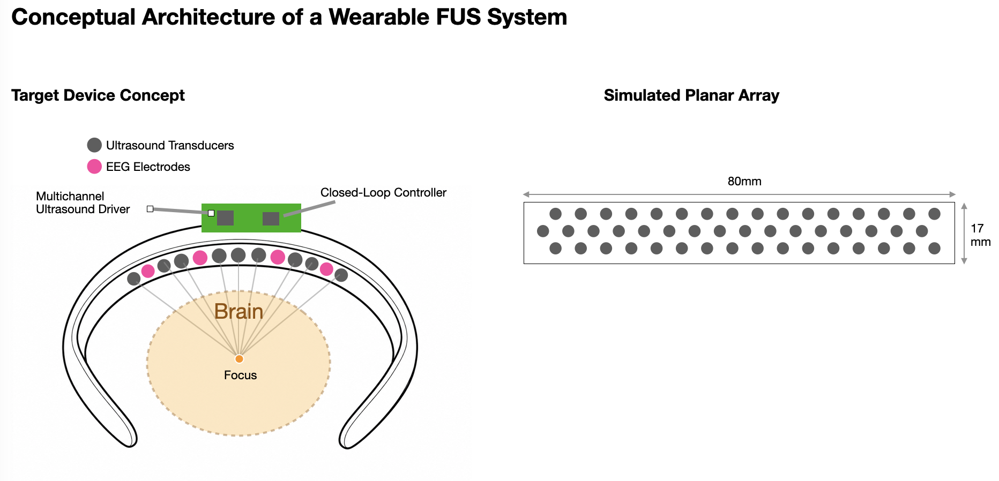
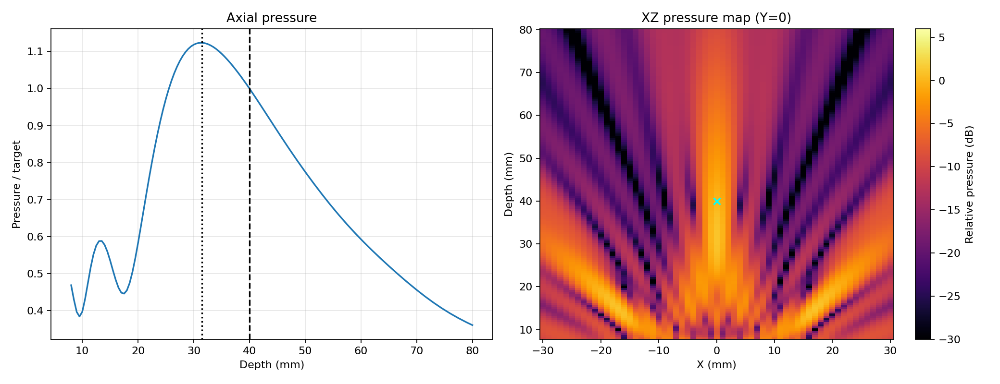
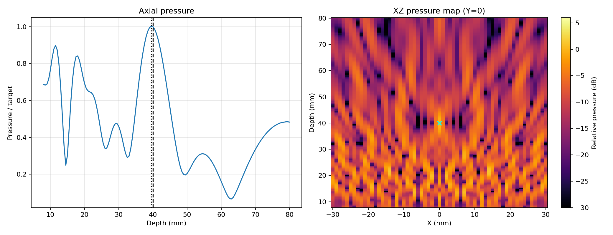
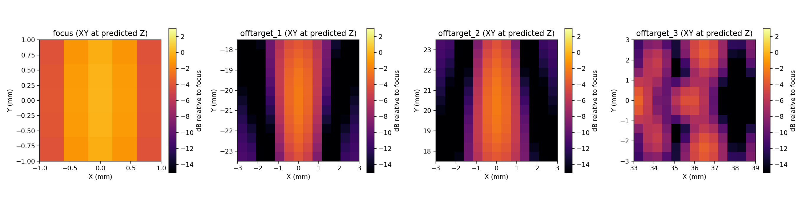
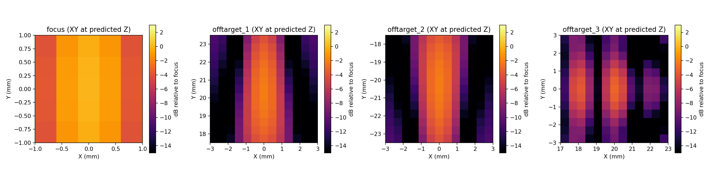

# Ultrasound Array Exploration

**Independent computational study of narrow ultrasound phased arrays for wearable transcranial neuromodulation**

I am exploring a long-term concept for a **self-contained, headband-form-factor focused ultrasound (FUS) system** with onboard driving electronics, power, neural sensing, and eventually closed-loop control. A fundamental engineering question is whether an array constrained to a narrow headband can maintain useful acoustic focusing with fewer transducer elements.

This repository documents my initial investigation of **array aperture, element placement, focal pressure, off-target pressure, and a preliminary system power budget**.

> **Status (November 2026):** Early-stage simulation research. No physical FUS prototype, transcranial validation, or neural stimulation experiments are reported here.

## 1. Target device concept

The envisioned device is a slim headband containing ultrasound transducers and, ultimately, onboard electronics and sensing. The form factor is a **design goal**, not an accomplished device.




*Concept illustration only. The simulations below model planar arrays in homogeneous water, not the illustrated curved head-worn device. The depicted brain focus is an intended targeting concept, not a demonstrated transcranial result.*

## 2. Research questions and methods

I began by screening element counts, array layouts, and narrow-band widths using analytical acoustic models. I then used **3D k-Wave simulations** to check selected focal-width and off-target pressure predictions. Finally, I used an **assumption-based power-budget model** to examine whether reducing element count could also reduce estimated average electrical power.

The principal comparisons use the following modeling conditions:

| Parameter | Value |
|---|---|
| Ultrasound frequency | 500 kHz |
| Intended focus | (0, 0, 40) mm |
| Narrow-array footprint | 80 × 17 mm |
| Modeled transducer diameter | 2 mm |
| Medium | Homogeneous water |
| k-Wave source representation | Rasterized additive-pressure disk approximation |
| Evaluated layouts | Aligned, staggered, and randomized arrangements |

The k-Wave source model is **not a calibrated piezoelectric transducer**. Source amplitudes and the resulting focal pressures must not be interpreted as measured acoustic output or electrical efficiency.

## 3. Main findings

### 3.1 Longer aperture improved axial focusing, but did not eliminate off-target pressure

With **21 elements held constant**, extending the aperture from **30 to 80 mm** reduced the axial −3 dB focal width from **26.65 to 7.83 mm** in 3D k-Wave. The location of the maximum pressure on the central axis shifted closer to the requested 40 mm focus.

| 3D k-Wave, 21 elements | 30 mm aperture | 80 mm aperture |
|---|---:|---:|
| Axial pressure-peak depth | 31.5 mm | 39.5 mm |
| Axial −3 dB focal width | 26.65 mm | 7.83 mm |
| Lateral X focal width | 3.73 mm | 1.50 mm |

| 30 mm aperture | 80 mm aperture |
|---|---|
|  |  |

However, the sparse **80 mm, 21-element array** produced a strong off-target pressure hotspot. A targeted 3D k-Wave test found a peak **+1.14 dB relative to the intended focal pressure** near **(−14, 0, 21.5) mm**. Thus, a narrower focal width alone was not sufficient to guarantee better spatial selectivity.

**Evidence:** [Aperture comparison CSV](ultrasound_layout_sweep/aperture_length_results/kwave_completed_summary.csv) · [21-element off-target validation](ultrasound_layout_sweep/kwave_offtarget_validation/completed_comparison.csv)

### 3.2 A 48-element staggered layout showed similar sampled off-target pressure to a 60-element aligned layout

I next examined whether alternative element arrangements could preserve off-target pressure suppression with fewer elements. The initial analytical screen included **21, 36, 48, and 60 elements** in aligned, staggered, and randomized layouts. I selected a **48-element staggered** array and a **60-element aligned** reference for targeted 3D k-Wave comparison within the same **80 × 17 mm** aperture.

| Targeted 3D k-Wave result | 48 elements, staggered | 60 elements, aligned |
|---|---:|---:|
| Focal pressure (arbitrary units) | 111.31 | 125.06 |
| Strongest pressure in sampled off-target windows, relative to focus | **−2.246 dB** | **−2.196 dB** |
| Location of that hotspot (x, y, z) | (0, −20.5, 34.5) mm | (0, 20.0, 34.5) mm |

| 48-element sampled hotspot maps | 60-element sampled hotspot maps |
|---|---|
|  |  |

The two layouts produced **nearly identical relative pressure at the examined off-target hotspots**, while the 48-element array had **20% fewer transducers**. Its focal pressure was approximately **1 dB lower** under the simulation's specified source normalization (`1/sqrt(N)`).

These results suggest that fewer elements *may* provide comparable suppression at selected hotspots. They **do not establish identical full-field focusing performance, global optimality, or lower real-world power consumption**. Both element count and placement differed between the two layouts, so their individual contributions have not been isolated.

**Evidence:** [48/60 k-Wave comparison CSV](ultrasound_layout_sweep/kwave_sparse_48_vs_60/completed_comparison.csv) · [Study configuration](ultrasound_layout_sweep/kwave_sparse_48_vs_60/study_manifest.json)

### 3.3 Reducing element count did not always reduce estimated average electrical power

To see whether fewer elements might also reduce power consumption, I examined a **simplified, assumption-based power budget**. It combines the drive adjustment required to match the **instantaneous target focal pressure** with assumed transducer loading, driver efficiency, per-channel electronic overhead, fixed shared power, and stimulation duty cycle.

| Assumed operating conditions | 48 elements | 60 elements | Lower estimate |
|---|---:|---:|---|
| 1 mW/channel, 10% duty | 128.89 mW | 128.24 mW | 60 elements |
| 2 mW/channel, 10% duty | 176.89 mW | 188.24 mW | 48 elements |
| 1 mW/channel, 5% duty | 98.45 mW | 104.12 mW | 48 elements |

Under the assumed model, **the array with lower estimated average power changed when per-channel electronic power or duty cycle changed**. Having fewer channels reduces electronic overhead, but the remaining elements may need more drive to reach the same focal pressure.

**Key insight:** Acoustic-array geometry and driving electronics should be **optimized together**, rather than independently, when designing a compact, energy-efficient FUS system.

These numbers are **illustrative model outputs, not measured consumption**. The assumed element properties (including 100 pF capacitance, 20 kΩ equivalent parallel real load, and 70% driver efficiency) have not been experimentally validated. Equal focal pressure *while transmitting* also does **not** mean equal delivered stimulation dose or biological efficacy when duty cycle changes.

**Model and individual result sets:**

- [Power-budget Python script](ultrasound_layout_sweep/estimate_fus_power.py)
- [1 mW/channel, 10% duty](ultrasound_layout_sweep/fus_power_estimates/fus_power_estimates_--channel-mw_1/power_budget_example.csv)
- [2 mW/channel, 10% duty](ultrasound_layout_sweep/fus_power_estimates/fus_power_estimates_--channel-mw_2/power_budget_example.csv)
- [1 mW/channel, 5% duty](ultrasound_layout_sweep/fus_power_estimates/fus_power_estimates_--duty_0.05/power_budget_example.csv)
- [Model assumptions](ultrasound_layout_sweep/fus_power_estimates/fus_power_estimates_--channel-mw_1/model_assumptions.txt)

## 4. Code and data

| Study | Python script | Output |
|---|---|---|
| Initial headband-width/layout screen | [ultrasound_layout_sweep_v3_headband.py](ultrasound_layout_sweep/ultrasound_layout_sweep_v3_headband.py) | [Initial results](ultrasound_layout_sweep/layout_sweep_results_v3_headband/) |
| Aperture length | [aperture_length_study.py](ultrasound_layout_sweep/aperture_length_study.py) | [Aperture results](ultrasound_layout_sweep/aperture_length_results/) |
| Sparse-array geometry screen | [sparse_array_screen.py](ultrasound_layout_sweep/sparse_array_screen.py) | Analytical screening; selected layouts subsequently validated below |
| 21 vs. 60 off-target check | [validate_offtarget_kwave.py](ultrasound_layout_sweep/validate_offtarget_kwave.py) | [k-Wave results](ultrasound_layout_sweep/kwave_offtarget_validation/) |
| 48 vs. 60 off-target check | [kwave_validate_sparse_48_vs_60.py](ultrasound_layout_sweep/kwave_validate_sparse_48_vs_60.py) | [k-Wave results](ultrasound_layout_sweep/kwave_sparse_48_vs_60/) |
| Simplified electrical power budget | [estimate_fus_power.py](ultrasound_layout_sweep/estimate_fus_power.py) | [Three sensitivity-analysis runs](ultrasound_layout_sweep/fus_power_estimates/) |

### Reproducing the power-budget sensitivity analysis

From the `ultrasound_layout_sweep/` directory, using a Python environment with the required dependencies:

```bash
python estimate_fus_power.py --comparison kwave_sparse_48_vs_60/completed_comparison.csv \
  --channel-mw 1 --duty 0.10 \
  --out fus_power_estimates/fus_power_estimates_--channel-mw_1

python estimate_fus_power.py --comparison kwave_sparse_48_vs_60/completed_comparison.csv \
  --channel-mw 2 --duty 0.10 \
  --out fus_power_estimates/fus_power_estimates_--channel-mw_2

python estimate_fus_power.py --comparison kwave_sparse_48_vs_60/completed_comparison.csv \
  --channel-mw 1 --duty 0.05 \
  --out fus_power_estimates/fus_power_estimates_--duty_0.05
```

The acoustic studies use Python, NumPy, SciPy, Matplotlib, and k-wave-python. Full 3D k-Wave runs are computationally more expensive than analytical field evaluations.

## 5. Limitations and next steps

**What this study has not established:**

- Acoustic focusing through a human skull, or coupling to a curved head-worn array
- The strongest possible off-target pressure across the entire 3D field; k-Wave checks sampled **selected candidate regions**
- Measured acoustic output, transducer efficiency, or calibrated electrical power
- Actual size, mass, temperature rise, and battery runtime of a self-contained device
- Neural effects, closed-loop performance, or human safety and efficacy

The next research challenge is to determine whether these geometric trade-offs hold in **skull-aware models** and then co-design the **transducer array, phase-control electronics, and power budget** for a genuinely self-contained device.
